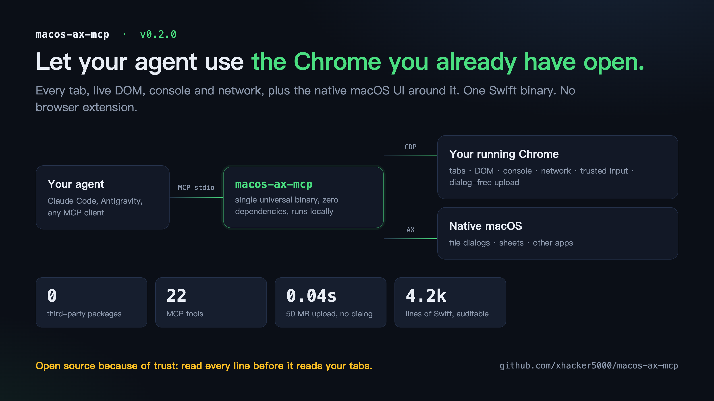
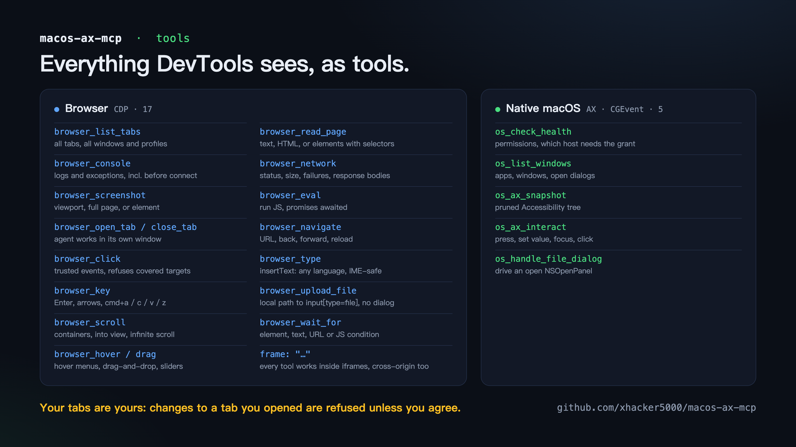
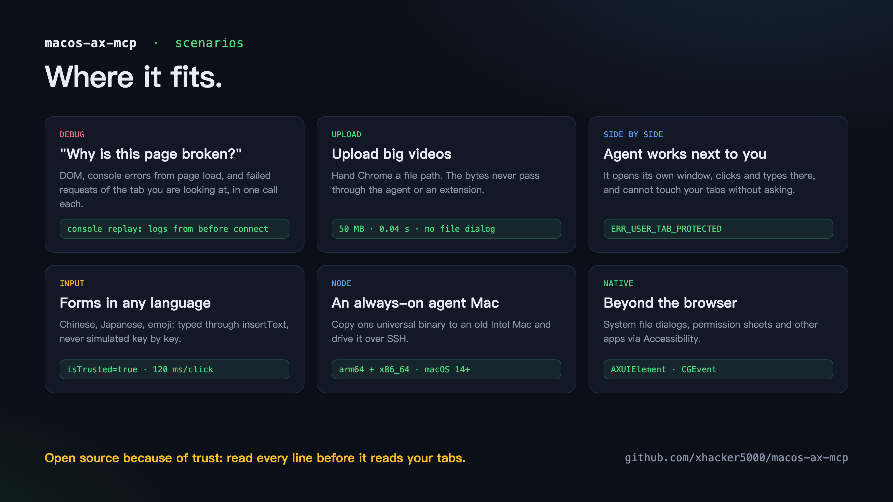

# macos-ax-mcp

A single-binary, zero-dependency MCP server that lets a local coding agent (Claude Code, Antigravity, any MCP client) **see and operate the Chrome you are actually using** — every tab, the live DOM, console, network — plus the native macOS UI around it. No browser extension.

[中文说明](README.zh-CN.md)



```
agent ──MCP stdio──▶ macos-ax-mcp ──CDP──────────▶ your running Chrome (tabs, DOM, console, network, input)
                                  └─Accessibility─▶ native macOS UI (file dialogs, sheets, other apps)
```

## Design philosophy

**Accessibility is a means, not the goal.** The goal is simple: when I ask the agent "look at this page", it should see what DevTools sees in the browser I already have open, with my logins, my tabs, my state. Everything in this tool serves that sentence.

1. **Open source because of trust.** A tool that can read every logged-in tab you have should not be a black box. The whole thing is ~4.2k lines of Swift with zero third-party packages, so you can read all of it in an evening and build it yourself instead of trusting a binary.
2. **Talk to the platform directly, skip the middlemen.** Browser extensions sit in a sandbox, cap payload sizes, need their own login, and disconnect. Chrome already ships a first-class automation protocol (CDP) and macOS already ships one for native UI (AXUIElement). This tool speaks both natively.
3. **Deterministic, not visual.** No screenshots-then-guess loops, no OCR. Every action is a state machine over real protocol state, with an error code and a step trace when it fails. Screenshots exist for *you*, not for decision-making.
4. **Your tabs are yours.** Reading is free. Anything that changes a page you opened (click, type, navigate, scroll, hover, drag, upload, close) is refused with `ERR_USER_TAB_PROTECTED` unless the agent passes `confirm_user_tab: true`, which it may only do after you said yes. The agent works in its own tabs (`browser_open_tab`). This is enforced in the binary, not left to a prompt.
5. **Small and reproducible.** Swift + Apple frameworks only, offline-deterministic build. Universal (arm64 + x86_64), runs on macOS 14+ without Xcode installed.
6. **Fail loudly.** stdout carries only JSON-RPC frames (fd 1 is redirected to stderr at startup so a stray print can never corrupt the stream); every tool error is structured `{error_code, error_detail, ...}`; the MCP process never crashes on a tool failure.
7. **Real input is a scarce resource.** Synthetic OS keystrokes need the foreground and an unlocked screen, so they are the last resort, never the default. Browser input goes through CDP (trusted, background-capable); IME-sensitive text goes through `Input.insertText` or the pasteboard, never simulated character keys.

## What it can do



### Browser (CDP, works in the background)

| Tool | What you get |
|---|---|
| `browser_list_tabs` | All tabs across all windows and profiles; flags the one shown in the front window |
| `browser_read_page` | `text`, full `html`, `elements` (interactive elements with CSS selectors, values, file-input state, off-screen detection, shadow DOM), or `frames` (the page's iframes) |
| `browser_console` | console calls, uncaught exceptions, browser log entries; **includes messages logged before the agent connected** (Chrome's buffer is replayed); extension noise filtered by default |
| `browser_network` | requests with status, type, size, duration, failure reason; fetch any response body |
| `browser_screenshot` | viewport, full page or one element, saved as PNG/JPEG |
| `browser_eval` | evaluate JS, promises awaited |
| `browser_wait_for` | wait for an element to appear / disappear, text, a URL, or a JS condition (instead of fixed sleeps) |
| `browser_open_tab` / `browser_close_tab` | the agent's own tabs (own window by default, does not steal keyboard focus) |
| `browser_navigate` | URL, back, forward, reload; waits for load |
| `browser_click` | trusted mouse events (`isTrusted=true`), scrolls into view, refuses covered elements |
| `browser_type` | `Input.insertText`: any language, IME-safe, optional clear and Enter |
| `browser_key` | Enter, Tab, arrows, `cmd+a` / `c` / `v` / `x` / `z` mapped to real editing commands |
| `browser_scroll` | up / down / top / bottom / into view, inside any scrollable element; infinite scroll with automatic stop when no more content loads |
| `browser_hover` | real mouse move, opens hover menus and tooltips |
| `browser_drag` | HTML5 drag-and-drop (kanban, drop zones) and pointer dragging (sliders, sortable lists, canvas) |
| `browser_upload_file` | attach a local file to `<input type=file>` **without opening the file dialog**; 50 MB in 0.04 s, multi-GB fine |

Tabs are addressed by id, by a title/URL substring, or `active` (the tab in Chrome's front window, resolved via Accessibility). Reading, eval, click, type, hover, drag, scroll, wait and upload all take an optional `frame` to work inside an iframe, **cross-origin iframes included**; coordinates are mapped to the page automatically.

### Native macOS (Accessibility + CGEvent)

| Tool | What you get |
|---|---|
| `os_check_health` | TCC trust, macOS version, which host process needs the Accessibility grant |
| `os_list_windows` | apps, windows, open sheets / file dialogs |
| `os_ax_snapshot` | pruned AX tree with ephemeral element ids |
| `os_ax_interact` | press / set_value / focus / click_center with fallbacks |
| `os_handle_file_dialog` | drive an already-open NSOpenPanel via Go-to-Folder + clipboard paste (fallback when CDP upload is not possible) |

## Scenarios



- **"What's on this page / why is it broken?"** Read the DOM, the console errors (including the ones from page load), and the failed requests of the tab you are looking at, in one go.
- **Uploading large videos to creator platforms.** `browser_upload_file` hands Chrome a path; the bytes never pass through the agent or an extension.
- **Letting the agent work next to you.** It opens its own window, clicks and types there, and cannot touch your tabs without asking.
- **A dedicated always-on Mac as an agent node.** Copy one universal binary to an old Intel Mac (`HOST=node scripts/deploy_remote.sh`) and drive it over SSH.
- **Native UI the browser cannot reach:** system file dialogs, permission sheets, other apps.

## Install

Prebuilt universal binary: see [Releases](https://github.com/xhacker5000/macos-ax-mcp/releases). It is ad-hoc signed, not notarized, so after downloading run `xattr -d com.apple.quarantine macos-ax-mcp` (or just build it yourself, below).

```bash
git clone https://github.com/xhacker5000/macos-ax-mcp && cd macos-ax-mcp
swift build -c release --arch arm64 --arch x86_64
install -m 0755 .build/apple/Products/Release/macos-ax-mcp ~/.local/bin/macos-ax-mcp

# Claude Code, all projects
claude mcp add -s user macos-ax -- ~/.local/bin/macos-ax-mcp
```

Generic MCP config:

```json
{ "mcpServers": { "macos-ax": { "command": "/Users/you/.local/bin/macos-ax-mcp", "args": [] } } }
```

### Enable the two permissions

1. **Chrome:** open `chrome://inspect/#remote-debugging` and turn on *Allow remote debugging for this browser instance* (Chrome 144+). No separate profile, no relaunch.
2. **macOS Accessibility** (only for the `os_*` tools): System Settings › Privacy & Security › Accessibility, enable the app that launches the server (Terminal, iTerm2, your IDE). `macos-ax-mcp --cli check-health` tells you which process that is.

### CLI debug mode

```bash
macos-ax-mcp --cli check-health
macos-ax-mcp --cli list-tools
macos-ax-mcp --cli call browser_list_tabs
macos-ax-mcp --cli call browser_read_page '{"tab":"active","mode":"elements"}'
```

## Honest trade-offs

- **Chrome asks you to approve every new debugging connection.** In MCP mode the server keeps one connection, so it is one click per agent session (each `--cli` run asks again). While connected, Chrome shows the "controlled by automated test software" bar.
- **The debugging switch is powerful.** While it is on, any local app can *request* control of your browser; each request still needs your click. Turn it off when you don't need it.
- **Hidden background tabs ignore input.** Chrome does not process mouse/key events for hidden tabs, so `browser_open_tab` uses its own window by default; clicks on hidden tabs fail fast with `ERR_TAB_HIDDEN`. Reading, screenshots and network work everywhere.
- **Local only.** It runs where your MCP client runs; it is not a cloud service.
- **Native dialog flow is the fallback path.** `os_handle_file_dialog` needs the foreground and an unlocked screen, and has not been fully validated on macOS 26 yet. Prefer `browser_upload_file`.

## Development

```bash
swift build && swift test          # 25 tests: protocol framing over real pipes, clipboard round-trip, pruning, validation
open scripts/e2e_file_upload_test.html   # manual upload harness (shows name / MIME / exact byte size)
```

Requires Swift 5.9+, macOS 14+. MIT licensed.
