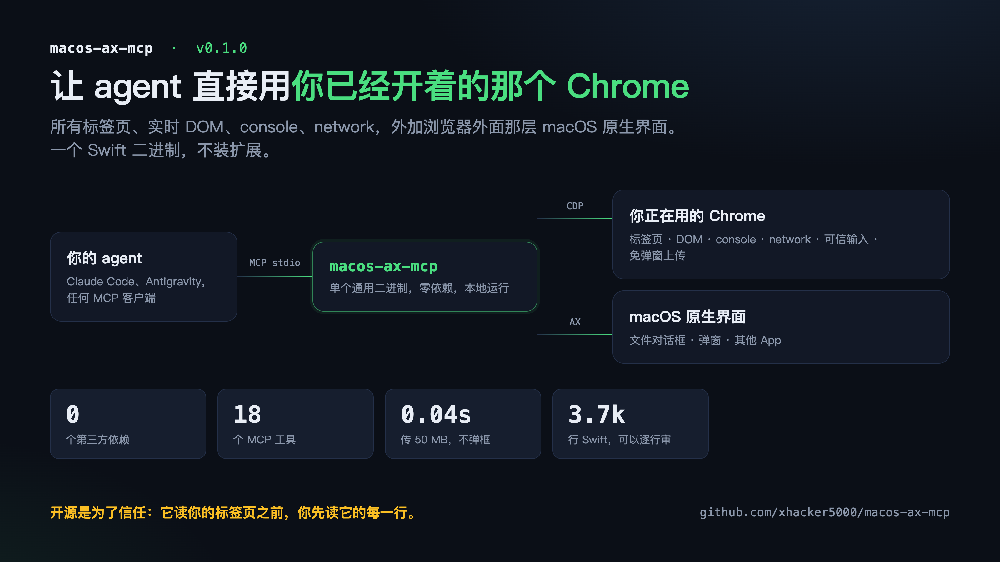
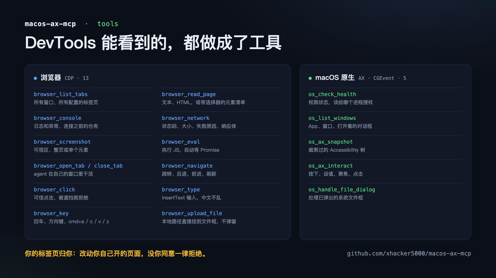
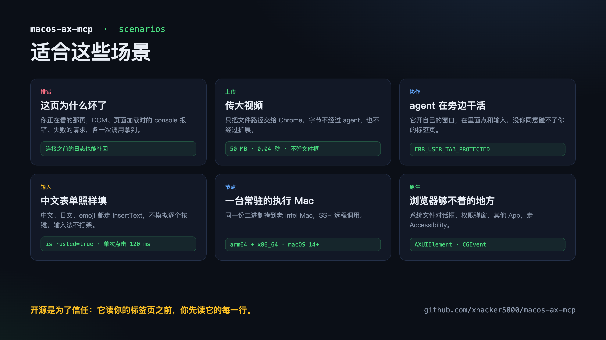

# macos-ax-mcp

一个 Swift 单文件二进制，零依赖的 MCP server。让本地的 coding agent（Claude Code、Antigravity 或任何 MCP 客户端）直接看到、直接操作你正在用的那个 Chrome：所有标签页、实时 DOM、console、network 都能拿到，浏览器外面那层 macOS 原生界面也能处理。不需要装浏览器扩展。

[English](README.md)



agent 通过 MCP stdio 调用 macos-ax-mcp。浏览器里的事走 Chrome DevTools Protocol（CDP），直连你正在运行的 Chrome；浏览器管不到的原生弹窗和其他 App，走 macOS 的 Accessibility。

## 设计哲学

Accessibility 只是手段，目标很简单：我跟 agent 说帮我看看这个页面，它看到的应该和 DevTools 看到的一样，而且就是我已经开着的那个浏览器，带着我的登录态、我的标签页。这个工具里的每个设计都服务这一句话。

1. **开源是为了信任。** 一个能读你所有已登录标签页的工具，不该是黑盒。整个项目 3700 多行 Swift，没有任何第三方包，一个晚上能读完，读完自己编译，不用信我发的二进制。
2. 直接跟平台对话，不要中间商。扩展跑在沙盒里，传文件有大小上限，要单独登录，还会掉线。Chrome 自己就带一套一等公民的自动化协议（CDP），macOS 也有一套原生界面接口（AXUIElement），这个工具两套都原生说。
3. 确定性，不靠看图猜。没有截图再识别的循环，没有 OCR。每个动作都是基于协议状态的状态机，失败时给错误码和每一步的 trace。截图功能是给人看的，不拿来做决策。
4. 你的标签页归你。读随便读。凡是会改动你自己开的页面的操作（点击、输入、跳转、上传、关闭），工具直接拒绝并返回 `ERR_USER_TAB_PROTECTED`，除非 agent 传 `confirm_user_tab: true`，而这个参数只有你点头之后它才能传。agent 干活用它自己开的标签页（`browser_open_tab`）。这条规则写死在二进制里，不靠提示词自觉。
5. 小，可复现。只用 Swift 和 Apple 自带框架，离线也能确定性编译。通用二进制（arm64 和 x86_64），macOS 14 以上不装 Xcode 也能跑。
6. 出错要大声。stdout 只走 JSON-RPC 帧，启动时把 fd 1 重定向到 stderr，任何误打的 print 都污染不了协议流。工具出错一律返回结构化的 `error_code` 和 `error_detail`，进程不会因为某个工具失败而挂掉。
7. 真实键鼠输入是稀缺资源。系统级模拟按键要占前台，还不能锁屏，所以只当最后手段。浏览器里的输入走 CDP，可信，后台也能做；涉及输入法的文本走 `Input.insertText` 或剪贴板，从不模拟逐个字符按键。

## 能做什么



### 浏览器（CDP，后台可用）

| 工具 | 作用 |
|---|---|
| `browser_list_tabs` | 所有窗口、所有用户配置的标签页，标出你前台正在看的那个 |
| `browser_read_page` | 纯文本、完整 HTML，或可交互元素清单（带 CSS 选择器、输入框的值、文件框状态、是否在屏幕外，支持 shadow DOM） |
| `browser_console` | console 输出、未捕获异常、浏览器日志。连接之前打的日志也能拿回来，Chrome 会把缓存重放一遍；扩展的噪音默认过滤 |
| `browser_network` | 请求的状态码、类型、大小、耗时、失败原因，能取任意响应体 |
| `browser_screenshot` | 可视区、整页或单个元素，存成 PNG 或 JPEG |
| `browser_eval` | 执行 JS，自动等 Promise |
| `browser_open_tab` / `browser_close_tab` | agent 自己的标签页，默认独立窗口，不抢键盘焦点 |
| `browser_navigate` | 打开网址、后退、前进、刷新，等加载完成 |
| `browser_click` | 可信鼠标事件（`isTrusted=true`），先滚到可见，被遮挡就拒绝 |
| `browser_type` | 用 `Input.insertText` 输入，任何语言，输入法安全，可先清空、可输完回车 |
| `browser_key` | 回车、Tab、方向键，`cmd+a` `cmd+c` `cmd+v` `cmd+x` `cmd+z` 映射成真正的编辑命令 |
| `browser_upload_file` | 把本地文件挂到 `<input type=file>`，不弹文件选择框。50 MB 用时 0.04 秒，几 GB 也没问题 |

指定标签页可以用 id、标题或网址的片段，或者 `active`，表示 Chrome 前台窗口里正在显示的那页（通过 Accessibility 识别）。

### macOS 原生（Accessibility 和 CGEvent）

| 工具 | 作用 |
|---|---|
| `os_check_health` | 辅助功能授权状态、系统版本，告诉你该给哪个宿主进程授权 |
| `os_list_windows` | App、窗口、打开着的 sheet 和文件对话框 |
| `os_ax_snapshot` | 裁剪过的 AX 树，带临时元素 id |
| `os_ax_interact` | 按下、设值、聚焦、点中心，带多级回退 |
| `os_handle_file_dialog` | 处理已经弹出的 NSOpenPanel，用前往文件夹加剪贴板粘贴，CDP 上传用不了的时候兜底 |

## 适合什么场景



- 这个页面上有什么，为什么坏了。一次把你正在看的那页的 DOM、console 报错（包括页面加载时的）、失败的请求全拿到。
- 往创作者平台传大视频。`browser_upload_file` 只把路径交给 Chrome，文件字节不经过 agent，也不经过扩展。
- agent 在你旁边干活。它开自己的窗口，在里面点和输入，没你同意碰不了你的标签页。
- 一台时刻待机的 Mac 当 agent 执行节点。把同一份通用二进制拷到一台老 Intel Mac 上（`HOST=节点别名 scripts/deploy_remote.sh`），通过 SSH 调用。
- 浏览器够不着的原生界面：系统文件对话框、权限弹窗、其他 App。

## 安装

编译好的通用二进制在 [Releases](https://github.com/xhacker5000/macos-ax-mcp/releases)。它是 ad-hoc 签名，没有经过 Apple 公证，下载后要执行 `xattr -d com.apple.quarantine macos-ax-mcp`。也可以按下面的步骤自己编译。

```bash
git clone https://github.com/xhacker5000/macos-ax-mcp && cd macos-ax-mcp
swift build -c release --arch arm64 --arch x86_64
install -m 0755 .build/apple/Products/Release/macos-ax-mcp ~/.local/bin/macos-ax-mcp

# 注册到 Claude Code，所有项目可用
claude mcp add -s user macos-ax -- ~/.local/bin/macos-ax-mcp
```

通用 MCP 配置：

```json
{ "mcpServers": { "macos-ax": { "command": "/Users/you/.local/bin/macos-ax-mcp", "args": [] } } }
```

### 打开两个权限

1. Chrome：打开 `chrome://inspect/#remote-debugging`，勾选 Allow remote debugging for this browser instance（Chrome 144 以上）。不用另开配置，不用重启浏览器。
2. macOS 辅助功能（只有 `os_*` 工具需要）：系统设置，隐私与安全性，辅助功能，打开启动这个 server 的 App（终端、iTerm2、IDE）。不确定是哪个，跑一下 `macos-ax-mcp --cli check-health`，它会告诉你。

### 命令行调试

```bash
macos-ax-mcp --cli check-health
macos-ax-mcp --cli list-tools
macos-ax-mcp --cli call browser_list_tabs
macos-ax-mcp --cli call browser_read_page '{"tab":"active","mode":"elements"}'
```

## 代价和限制

- Chrome 每个新的调试连接都要你点一次允许。MCP 模式下 server 只保持一个连接，所以每个 agent 会话点一次（命令行模式每跑一次都要点）。连接期间 Chrome 顶部会显示正受到自动测试软件控制。
- 调试开关权限很大。开着的时候，本机任何程序都能申请控制你的浏览器，只是每次都要你点允许。不用的时候关掉。
- 隐藏的后台标签页不响应输入。Chrome 不处理隐藏标签页的鼠标和键盘事件，所以 `browser_open_tab` 默认开独立窗口；对隐藏标签页点击会立刻返回 `ERR_TAB_HIDDEN`。读取、截图、network 在哪都能用。
- 只在本机。它跑在你的 MCP 客户端所在的机器上，不是云服务。
- 原生对话框那条路是兜底。`os_handle_file_dialog` 要占前台、不能锁屏，在 macOS 26 上还没完整验证。上传优先用 `browser_upload_file`。

## 开发

```bash
swift build && swift test          # 25 个测试：真实管道上的协议帧、剪贴板往返、裁剪、参数校验
open scripts/e2e_file_upload_test.html   # 手动上传测试页，显示文件名、MIME、精确字节数
```

需要 Swift 5.9 以上、macOS 14 以上。MIT 协议。
